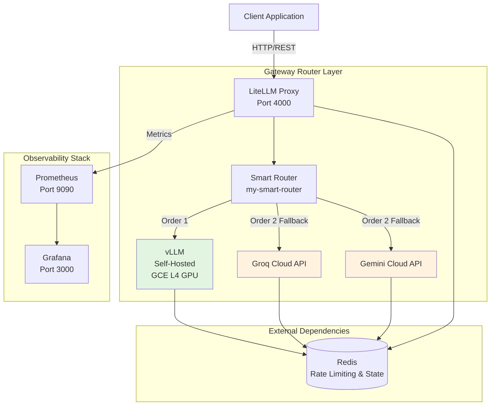

# Architecture Design

## Overview

LLM Serving Gateway is a distributed inference routing system that prioritizes self-hosted vLLM for cost-effective, low-latency generation, with automatic failover to cloud providers (Groq, Gemini) during overload or outage.

## High-Level Diagram

## Component Details

### 1. LiteLLM Proxy (Gateway Router)
- **Image:** `ghcr.io/berriai/litellm:v1.103.0`
- **Port:** 4000 (local), dynamic via `${PORT}` (Cloud Run)
- **Config:** `litellm-proxy/config.yaml`
- **Responsibilities:**
  - Request routing with priority ordering
  - Rate limit enforcement (RPM/TPM)
  - Failover trigger on timeout or failure
  - Master key authentication

### 2. vLLM Inference Engine (Layer 1)
- **Image:** `vllm/vllm-openai:v0.30.0`
- **Model:** Qwen2.5-14B-Instruct-AWQ (4-bit quantized)
- **Hardware:** NVIDIA L4 GPU (24 GB VRAM)
- **Deployment:** Google Compute Engine (GCE)
- **Key Config:**
  - `max_model_len: 512`
  - `max_num_seqs: 256`
  - `gpu_memory_utilization: 0.90`

### 3. Cloud Backup Providers (Layer 2)
| Provider | Model | Role |
|----------|-------|------|
| Groq | `openai/gpt-oss-20b` | Fallback Order 2 |
| Gemini | `gemini-2.5-flash-lite` | Fallback Order 2 |
| Gemini | `gemini-3.5-flash-lite` | Fallback Order 2 |

> ⚠️ Verify Gemini model names against LiteLLM provider docs. `gemini-2.5` / `gemini-3.5` may not be valid public model IDs.

### 4. Redis
- **Purpose:** Distributed rate limiting, router cooldown state, request deduplication
- **Deployment:** External (Google Memorystore or Redis Labs in production)

### 5. Monitoring (Prometheus + Grafana)
- **Prometheus:** Scrapes vLLM `/metrics` and LiteLLM metrics
- **Grafana:** Visualization dashboard
- **Network:** Shared `shared-monitor-network` Docker network

## Request Flow

1. Client sends `POST /v1/chat/completions` to LiteLLM Proxy with `Authorization: Bearer <MASTER_KEY>`
2. Router selects model based on `order` priority (vLLM = Order 1)
3. Pre-call checks enforced via Redis (rate limits, cooldown)
4. If vLLM responds successfully → return response to client
5. If vLLM fails/times out → fallback to Layer 2 (Groq/Gemini) based on usage-based load balancing
6. All metrics emitted to Prometheus

## Network Architecture

- **Local Dev:** `docker-compose.local.yml` creates isolated network; Redis and vLLM must be reachable externally
- **Production:** Cloud Run (LiteLLM) → VPC private egress → GCE (vLLM) + Cloud APIs
- **CI/CD:** GitHub Actions with Workload Identity Federation (WIF) deploys to Cloud Run and GCE

## Failover Strategy

| Condition | Action |
|-----------|--------|
| vLLM timeout (3s) | Immediate fallback to Layer 2 |
| vLLM HTTP error | Allowed 1 fail, then cooldown 45s |
| Rate limit exceeded | Redis-enforced cooldown, route to next available model |
| All layers fail | Return error to client (`hide_errors: true` masks internals) |

## Security Model

- **Authentication:** `LITELLM_MASTER_KEY` required on all gateway requests
- **Network:** VPC private ranges only; no public egress except to approved cloud APIs
- **Secrets:** Stored in GCP Secret Manager; injected via GitHub Actions secrets
- **Identity:** OIDC / Workload Identity Federation for CI/CD (no long-lived keys)

## Deployment Environments

| Environment | Target | Trigger |
|-------------|--------|---------|
| Local | Docker Compose | `make dev-up` |
| Staging / Prod | Cloud Run (LiteLLM) | Push to `main` branch |
| Prod | GCE (vLLM + Monitoring) | Push to `main` branch |
